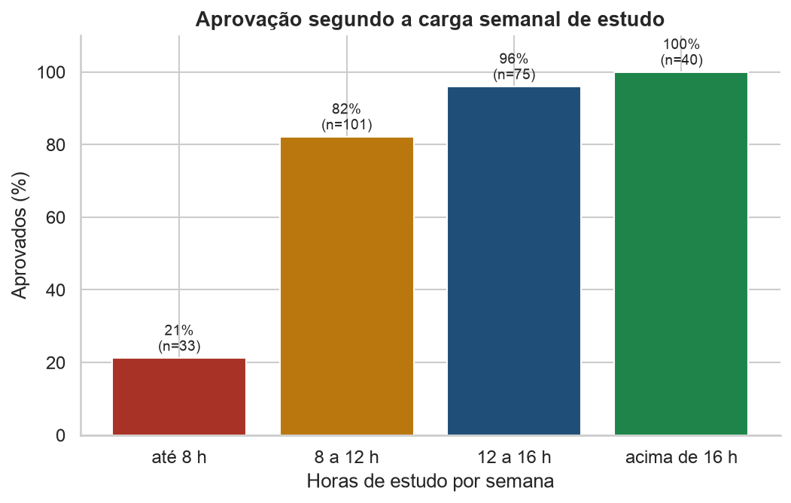
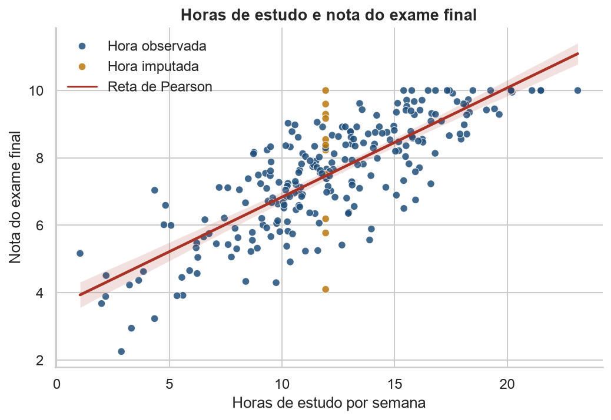

# Relatório executivo — EduTech Impacta Solutions

**Para:** gestão acadêmica da UNIMPACTA
**Assunto:** desempenho de 250 alunos na plataforma e onde agir
**Base:** `dados/edutech_performance.csv`, gerada com a semente 42 do exercício
**Complemento técnico:** `EP_AED_EduTech.ipynb`

A turma, vista pela média, vai bem. A nota média saneada é 7,52, com intervalo de 95% de confiança entre 7,31 e 7,72, e 80,8% dos alunos foram aprovados (202 de 250). O problema não está no centro da turma. Está nos 33 alunos que estudam até 8 horas por semana: a aprovação nesse grupo cai para 21%, e ele concentra 55% das reprovações, embora seja só 13% da base com nota válida.

## O que precisou ser corrigido antes da conta

O arquivo veio com três falhas, e cada uma foi tratada de um jeito diferente. O detalhe da conta está no Módulo I do notebook.

- Dez alunos sem carga horária, mais o registro `EMP-1005` com 99 horas semanais. Noventa e nove horas é erro de digitação: passa de 14 horas por dia e está fora do intervalo de 1 a 30 horas do próprio gerador. Esses 11 valores foram preenchidos com a mediana das horas válidas, 11,94 h. A mediana foi escolhida porque a média seria arrastada pelo 99, e remover 11 linhas jogaria fora 4% da amostra. A reta de regressão calculada só com quem tem hora observada é praticamente a mesma, então a imputação não fabricou o resultado.
- A taxa de conclusão estava em percentual (de 16,1% a 100%, sem valor negativo nem acima de 100). Foi dividida por 100 para ficar na escala de 0 a 1 pedida no roteiro.
- A nota −2,5 de `EMP-1012` está fora da escala de 0 a 10. Não foi imputada. Entrou só na demonstração de outlier e saiu das médias, dos testes de nota e da regressão. O status de aprovação dessa linha continuou "Não", porque foi gravado antes da corrupção da nota.

Manter o −2,5 na média puxa a nota média em 0,04 ponto e aumenta o desvio padrão em 7%. Esse único ponto responde por 13% da soma de quadrados. O 99 nas horas é pior: infla o desvio padrão da carga horária em 69%. Um painel de gestão calculado no arquivo cru misturaria falha de cadastro com desempenho.

## Onde está o risco de reprovação

A carga semanal de estudo é a variável que separa aprovado de reprovado nesta base.

| Faixa semanal | Alunos | Nota média | Aprovação |
|---|---:|---:|---:|
| Até 8 h | 33 | 5,06 | 21% |
| 8 a 12 h | 101 | 7,12 | 82% |
| 12 a 16 h | 75 | 8,16 | 96% |
| Acima de 16 h | 40 | 9,33 | 100% |

A reta simples cruza a nota 6, que é o corte de aprovação, por volta de 7,4 horas semanais. A faixa "até 8 h" foi cortada ao redor desse ponto. Não é um limiar mágico. O resíduo da reta ainda gira em torno de 1 ponto, então há aprovado abaixo de 8 horas e reprovado acima. Mesmo assim, a queda de 82% para 21% entre as duas primeiras faixas é grande demais para ser ruído de uma turma só.

Horas e nota andam juntas de forma aproximadamente linear. Pearson deu r = 0,79 e Spearman deu ρ = 0,77, os dois com valor-p praticamente nulo. A proximidade dos dois coeficientes indica que a relação não é uma curva disfarçada nem um efeito de um ponto isolado.

A equação ajustada por mínimos quadrados, na série saneada, é:

**Nota prevista = 3,598 + 0,324 × horas semanais**

Cada hora a mais na semana está associada, em média, a 0,32 ponto na nota. Quatro horas a mais, cerca de 50 minutos em cada dia útil, correspondem a cerca de 1,3 ponto. O R² é 0,629: 62,9% da variância da nota acompanha as horas. O restante fica no resíduo.

Quando a taxa de conclusão entra no modelo, a equação passa a ser:

**Nota prevista = 1,806 + 0,212 × horas + 4,173 × taxa de conclusão**

A taxa está na escala de 0 a 1. Dez pontos percentuais a mais de módulos concluídos estão associados a 0,42 ponto na nota. O R² ajustado sobe de 0,628 para 0,760. A conclusão acrescenta informação que as horas não carregavam sozinhas. O coeficiente das horas cai de 0,324 para 0,212 porque parte do efeito simples era, na verdade, conclusão de módulo: horas e taxa de conclusão se correlacionam (r = 0,60). As duas variáveis continuam relevantes. Uma não é disfarce da outra.

Isso não autoriza a frase "obrigar o aluno a estudar X horas garante a nota". Motivação, base anterior e dificuldade do curso não estão na base e podem empurrar horas e nota ao mesmo tempo. A associação é forte o bastante para virar regra de acompanhamento. Não é forte o bastante para virar promessa de resultado.

A reta também mente fora da faixa observada. Em 50 horas semanais ela prevê nota 19,8, impossível numa escala de 0 a 10. O máximo observado fica perto de 23 horas, e 15 alunos já estão empilhados na nota 10. A equação vale dentro da carga que a turma de fato tem.

## O que esta amostra não sustenta

Duas hipóteses naturais da gestão não passaram no teste de 5%.

**Nível de ensino não explica a aprovação.** Extensão aprova 86,8%, Pós-Graduação 83,6% e Graduação 76,6%. O qui-quadrado foi 2,99, abaixo do crítico 5,99, com p = 0,225. O V de Cramer foi 0,11, associação fraca. Todas as frequências esperadas ficaram acima de 5, então o teste é adequado. A diferença descritiva da Graduação merece acompanhamento. Ela não sustenta, sozinha, uma mudança de desenho por nível.

**Barra Funda não tem nota média diferente do EAD.** As médias são 7,32 e 7,68. O teste t de Student deu t = −1,29, dentro do crítico ±1,98, com p = 0,201. As variâncias podem ser tratadas como iguais (Levene, p = 0,716). Welch e Mann-Whitney contam a mesma história. Barra Funda também tem a menor aprovação (76,7%, contra 84,8% no EAD), mas a amostra não separa esse gap do acaso.

A carga horária entre Pós-Graduação e Graduação difere −1,2%. Em tempo, são cerca de 8 minutos por semana. Não há um grupo abandonando a plataforma.

Não rejeitar a hipótese nula não prova que a diferença seja zero. Prova que estes 250 registros não mostraram efeito além do acaso. Com associações fracas, a amostra pode deixar passar uma diferença pequena.

## Recomendações

1. **Acompanhar quem fica abaixo de 8 horas semanais nas primeiras semanas.** São 33 alunos, com nota média 5,06 e aprovação de 21%. É o único recorte desta base em que a reprovação deixa de ser exceção. O alerta deve disparar cedo, porque a taxa de conclusão já carrega informação da nota antes do exame e sobe junto com as horas.
2. **Não reorganizar polo nem nível de ensino com base neste corte.** As diferenças existem na descrição e não se sustentam no teste. Vale monitorar Barra Funda e a Graduação no próximo ciclo, com mais alunos, antes de mexer em oferta ou corpo docente.
3. **Travar no cadastro o que esta base deixou passar.** Nota fora de 0 a 10 e carga semanal acima de 30 horas devem ser recusadas na entrada. Um único 99 destruiu a dispersão das horas, e um único −2,5 moveu o desvio padrão da nota.
4. **Não usar a reta para meta de 50 horas, nem para aluno que não estuda.** O intercepto 3,60 é a âncora da equação, não a nota de alguém com carga zero. Cinquenta horas extrapola a amostra e fura o teto da escala.

## Anexo — números do roteiro

| Grandeza | Resultado |
|---|---|
| P(Aprovado) | 0,808 (202/250) |
| P(Pós-Graduação) | 0,292 (73/250) |
| P(Aprovado dado Pós-Graduação), por Bayes | 0,836 (61/73) |
| P(exatamente 7 aprovados em 10 alunos) | 0,191 |
| P(nota > 8,5) pela normal | 0,274 (Z = 0,60) |
| Frequência observada de nota > 8,5 | 0,321 (80 de 249) |
| Média, mediana e média aparada a 5% da nota | 7,52; 7,63; 7,58 |
| Desvio padrão, IQR e CV da nota | 1,64; 2,25; 21,8% |
| Assimetria de Bowley e curtose em excesso | −0,007; −0,20 |
| Qui-quadrado (nível × aprovação) | 2,99; gl = 2; p = 0,225; V = 0,11 |
| Teste t, Barra Funda × EAD | t = −1,29; gl = 124; p = 0,201 |
| Pearson e Spearman (horas × nota) | 0,793; 0,774 |
| R² simples e R² ajustado múltiplo | 0,629; 0,760 |
| IC 95% da média das notas | [7,31; 7,72] |

A nota individual não segue uma normal: o teste de Shapiro-Wilk rejeita, em boa parte porque 15 alunos estão na nota 10. A probabilidade teórica de passar de 8,5 responde ao roteiro e fica abaixo da frequência observada (27% contra 32%). Para falar de excelência, a gestão deve citar a frequência da base. O intervalo da média continua válido: com 249 notas, a média amostral se apoia no teorema central do limite mesmo que a nota de um aluno não seja normal.
